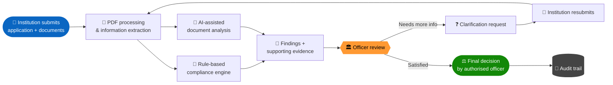
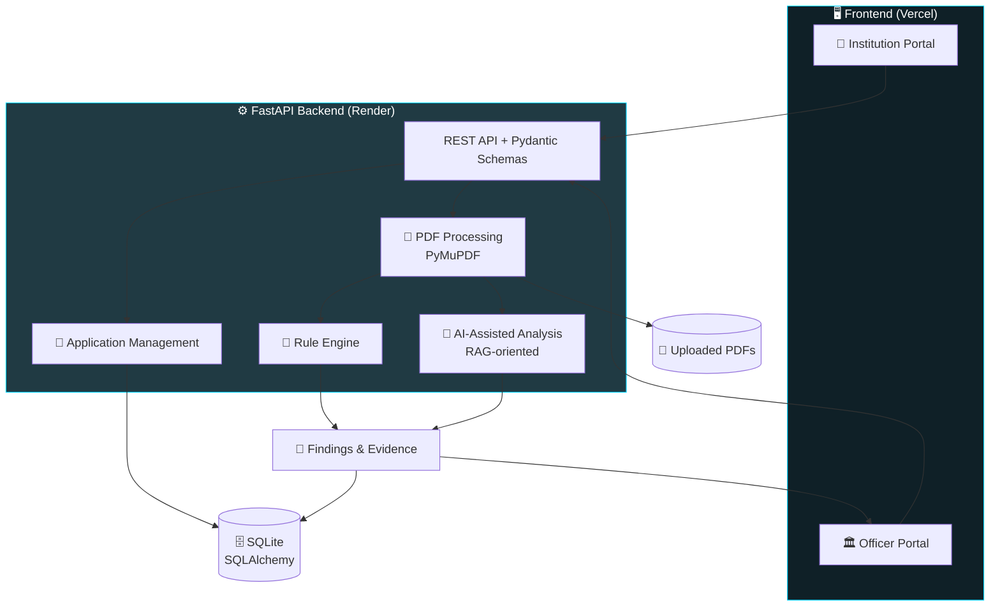

<div align="center">


<a href="https://github.com/AabisTechx/NIRIKSH">
  
</a>

<br/>


<br/>

### 🌐 [**Live Demo**](https://niriksh-frontend.vercel.app) &nbsp;•&nbsp; ⚙️ [**API Docs**](https://niriksh-suta.onrender.com/docs) &nbsp;•&nbsp; 🩺 [**Health Check**](https://niriksh-suta.onrender.com/api/health)

</div>

---

## 📑 Table of Contents

- [✨ What is NIRIKSH?](#-what-is-niriksh)
- [🎯 The Problem](#-the-problem)
- [💡 The Solution](#-the-solution)
- [⚙️ Key Features](#️-key-features)
- [🔄 System Workflow](#-system-workflow)
- [🏗️ Architecture](#️-architecture)
- [🧰 Tech Stack](#-tech-stack)
- [📸 Screenshots](#-screenshots)
- [🔐 Demo Access](#-demo-access)
- [🖥️ Run Locally](#️-run-locally)
- [🌐 Deployment](#-deployment)
- [📁 Repository Structure](#-repository-structure)
- [🔮 Future Scope](#-future-scope)
- [⚠️ Prototype Limitations](#️-prototype-limitations)
- [👥 Team](#-team)
- [📄 Disclaimer](#-disclaimer)

---

## ✨ What is NIRIKSH?

> **NIRIKSH** is an AI-assisted platform that streamlines the **AICTE institutional approval process** through document processing, compliance verification, application tracking and officer review.

It connects **institutions** and **regulatory officers** on a single, centralised digital workflow. It helps organise application scrutiny, flags missing information, tracks compliance findings and manages clarification requests.

NIRIKSH pairs **rule-based verification** with **AI-assisted document analysis** to keep scrutiny **transparent and traceable**.

<div align="center">

| 🧠 AI assists | 🧑‍⚖️ Humans decide |
|:---:|:---:|
| Extracts, checks, flags, suggests | **Final approval or rejection always rests with authorised officers** |

</div>

---

## 🎯 The Problem

<div align="center">

**Problem Statement ID: `SIH26262`**

*Integrated AICTE Approval Workflow Automation, Compliance Monitoring and Alert Management System*

</div>

AICTE approval is a multi-stage process involving application scrutiny, document verification, compliance monitoring, inspections and constant communication between institutions and regulators. Done manually, this leads to:

| 😓 Pain Point | 💥 Impact |
|---|---|
| Scattered, document-heavy scrutiny | Slow reviews, items missed |
| No unified view of application status | Poor tracking and low transparency |
| Manual compliance checks | Inconsistent and hard to audit |
| Back-and-forth clarification | Delays and lost context |
| Deadline and pendency management | Weak monitoring and oversight |

> 📌 A unified digital platform is needed to improve **workflow management, application tracking, compliance monitoring, deadline management and transparency**.

---

## 💡 The Solution

NIRIKSH delivers a **two-portal platform** backed by a single FastAPI engine.

<table>
<tr>
<td width="50%" valign="top">

### 🏫 Institution Portal
- 📊 Institution dashboard
- 📝 Application submission & tracking
- 📎 Supporting document submission
- 📄 In-app PDF document viewing
- 🚦 Application status monitoring
- 💬 Clarification requests & resubmission
- 🕒 Application communication tracking

</td>
<td width="50%" valign="top">

### 🏛️ AICTE / Officer Portal
- 🔍 Application overview & scrutiny dashboard
- ✅ Document review & verification
- 📌 Compliance findings with supporting evidence
- 📏 Rule-based compliance checks
- 🤖 AI-assisted document analysis
- ❓ Clarification requests to institutions
- ⚖️ Application decision management
- 🔎 EVC & inspection workflow support
- 🧾 Audit trail & application history

</td>
</tr>
</table>

---

## ⚙️ Key Features

| | Feature | Description |
|:-:|---|---|
| 🧩 | **Two-Portal Architecture** | Separate, purpose-built Institution and Officer interfaces |
| 📂 | **Application Management** | Submission, tracking and review in one place |
| 📄 | **PDF Processing** | Text extraction with page-level references |
| 📏 | **Compliance Verification** | Rule-based checks on selected requirements |
| 🤖 | **AI-Assisted Analysis** | RAG-oriented document analysis and suggestions |
| 🔗 | **Evidence Traceability** | Every finding linked back to its supporting document |
| 🔁 | **Clarification Workflow** | Request, correct and resubmit cycle |
| 🔎 | **EVC Management** | Inspection-related workflow support |
| 👁️ | **Supervisor Overview** | Application monitoring and oversight |
| 🧾 | **Audit Trail** | Record of application activities |

---

## 🔄 System Workflow



**Step by step**

1. 🏫 Institution submits an application and supporting documents.
2. 📄 Documents are processed to extract relevant information.
3. 📏 The compliance engine checks selected requirements.
4. 🤖 AI-assisted analysis generates additional findings and suggestions.
5. 🔍 Officers review findings alongside the supporting evidence.
6. ❓ Officers can request clarification.
7. 🔁 Institutions submit revised information.
8. ⚖️ Authorised officers record the final decision.
9. 🧾 Every activity is kept in the audit trail.

---

## 🏗️ Architecture



---

## 🧰 Tech Stack

<div align="center">

| Layer | Technologies |
|:---:|---|
| 🎨 **Frontend** |     |
| ⚙️ **Backend** |     |
| 📄 **Document Processing** |  Page-level document references |
| 🤖 **AI & Compliance** | Rule-based verification • AI-assisted document analysis • RAG-oriented processing |
| 🗄️ **Database** |   |
| 🚀 **Deployment** |    |

</div>

---

## 📸 Screenshots

> 💡 Add your screenshots to a `docs/screenshots/` folder and the images below will render automatically.

<div align="center">

| 🏫 Institution Dashboard | 🏛️ Officer Dashboard |
|:---:|:---:|
|  |  |

| 📌 Compliance Findings | ❓ Clarification Workflow |
|:---:|:---:|
|  |  |

</div>

---

## 🔐 Demo Access

Try both portals live at **[niriksh-frontend.vercel.app](https://niriksh-frontend.vercel.app)**.

| Portal | Username | Password |
|:---:|:---:|:---:|
| 🏫 Institution | `INST-DTI-2026` | `Niriksh@2026` |
| 🏛️ Officer | `AICTE-OFF-8841` | `Aicte#Scrutiny26` |

> ⚠️ These are **demonstration credentials** for **synthetic sample data only**. They are not real institutional or government accounts.
>
> ⏳ The backend runs on a hosted free-tier service, so the **first request may take a little while** to wake up.

---

## 🖥️ Run Locally

**Prerequisites:** Python 3.9+ • Git • a modern web browser

```bash
# 1️⃣ Clone the repository
git clone https://github.com/AabisTechx/NIRIKSH.git
cd NIRIKSH

# 2️⃣ Install backend dependencies
cd backend
pip install -r requirements.txt

# 3️⃣ Start the server
uvicorn main:app --reload --host 127.0.0.1 --port 8000
```

| 🔗 | URL |
|---|---|
| 🌐 Application | http://127.0.0.1:8000 |
| 📘 API Docs | http://127.0.0.1:8000/docs |

🪟 **On Windows?** Just double-click `START_NIRIKSH_WINDOWS.bat`.

> 🌱 Sample data is seeded automatically when the database is empty.

---

## 🌐 Deployment

NIRIKSH deploys as **two services**: a static frontend and a FastAPI backend.

| Component | Platform | Status |
|---|:---:|:---:|
| 🎨 Frontend | Vercel | 🟢 Live |
| ⚙️ Backend API | Render | 🟢 Live |
| 📘 API Docs | Render | 🟢 Live |
| 💻 Source Code | GitHub | 🟢 Public |

<details>
<summary><b>🔧 Backend on Render</b></summary>

- Create a **Web Service** from this repository
- **Root Directory:** `backend`
- **Runtime:** Python 3
- **Build Command:** `pip install -r requirements.txt`
- **Start Command:** `uvicorn main:app --host 0.0.0.0 --port $PORT`
- Set `NIRIKSH_CORS_ORIGINS` to your exact Vercel origin (no trailing slash)
- Test at `/api/health`

**Optional persistence** (attach a Render persistent disk mounted at `/var/data`):

```bash
NIRIKSH_DB_PATH=/var/data/niriksh_demo.db
NIRIKSH_UPLOAD_DIR=/var/data/uploads
```

</details>

<details>
<summary><b>🎨 Frontend on Vercel</b></summary>

- Set the backend URL in `frontend/public/config.js` (no trailing slash)
- Import the repository as a new Vercel project
- **Root Directory:** `frontend`
- **Framework Preset:** Other
- **Build / Install Command:** leave empty
- **Output Directory:** `public`

</details>

<details>
<summary><b>🧪 Smoke test checklist</b></summary>

Login • dashboard loading • case details • compliance checks • PDF display/upload • clarification & resubmission • EVC • audit logs

</details>

See [`DEPLOYMENT_GUIDE.md`](DEPLOYMENT_GUIDE.md) for the full walkthrough.

---

## 📁 Repository Structure

```
NIRIKSH/
│
├── 📂 backend/
│   ├── main.py              # FastAPI app entry point
│   ├── database.py          # Database setup
│   ├── models.py            # SQLAlchemy models
│   ├── schemas.py           # Pydantic schemas
│   ├── requirements.txt
│   ├── services/            # Business logic
│   ├── sample_data/         # Synthetic demo data
│   ├── scripts/
│   └── test_niriksh.py      # Tests
│
├── 📂 frontend/
│   ├── public/
│   │   ├── index.html
│   │   └── config.js        # Backend API URL
│   └── package.json
│
├── 📄 generate_sample_pdf.py
├── 🪟 START_NIRIKSH_WINDOWS.bat
├── 📘 DEPLOYMENT_GUIDE.md
├── 🔑 .env.example
└── 📖 README.md
```

---

## 🔮 Future Scope

- [ ] 🛣️ Configurable approval-stage routing
- [ ] 🗺️ Region-wise pendency and workload dashboards
- [ ] ⏱️ Time-bound undertaking tracking
- [ ] 📅 Lease and document expiry monitoring
- [ ] 🔔 Automated reminders and escalation mechanisms
- [ ] 🔒 Secure persistent document storage
- [ ] 🔗 Integration with authorised AICTE and government systems
- [ ] 🛡️ Enhanced role-based access control
- [ ] 🧬 Compliance rule versioning and validation

> These are proposed enhancements, not claims of completed implementation.

---

## ⚠️ Prototype Limitations

NIRIKSH is a **Smart India Hackathon 2026 prototype**.

- Uses **synthetic demonstration data** only
- AI-assisted analysis **supports, but never replaces,** authorised officer scrutiny
- The demo uses **SQLite**; persistent database and document storage are not guaranteed
- Integration with official AICTE and government systems is **not claimed**
- Production use would need security audits, persistent storage, monitoring and regulatory validation

---

## 👥 Team

<div align="center">

| 🏆 Team | 🎪 Competition | 🆔 Problem Statement | 🚀 Project |
|:---:|:---:|:---:|:---:|
| **CodeRanger** | Smart India Hackathon 2026 | SIH26262 | **NIRIKSH** |

</div>

---

## 📄 Disclaimer

NIRIKSH is an independent prototype developed for Smart India Hackathon 2026. It is **not** an official AICTE application or government service, and is not affiliated with or endorsed by AICTE or the Ministry of Education. All demonstration records are synthetic. Final regulatory decisions must remain with the competent authorities.

---

<div align="center">

### ⭐ If you find this project interesting, consider giving it a star!

**NIRIKSH — Making Institutional Approval Workflows More Transparent, Traceable and Accountable.**


</div>
