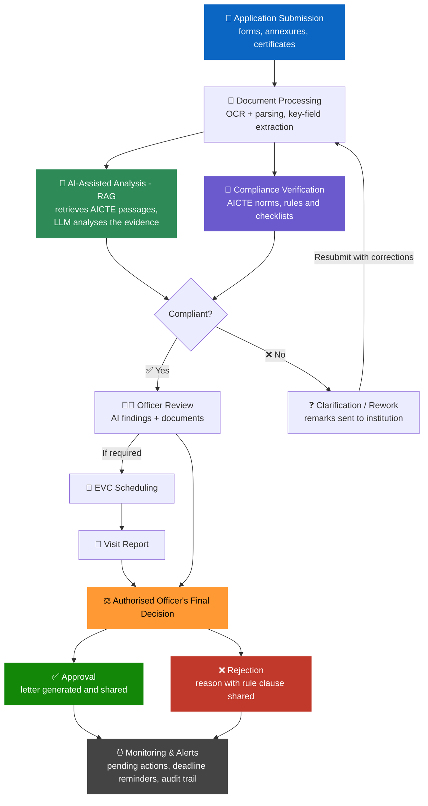
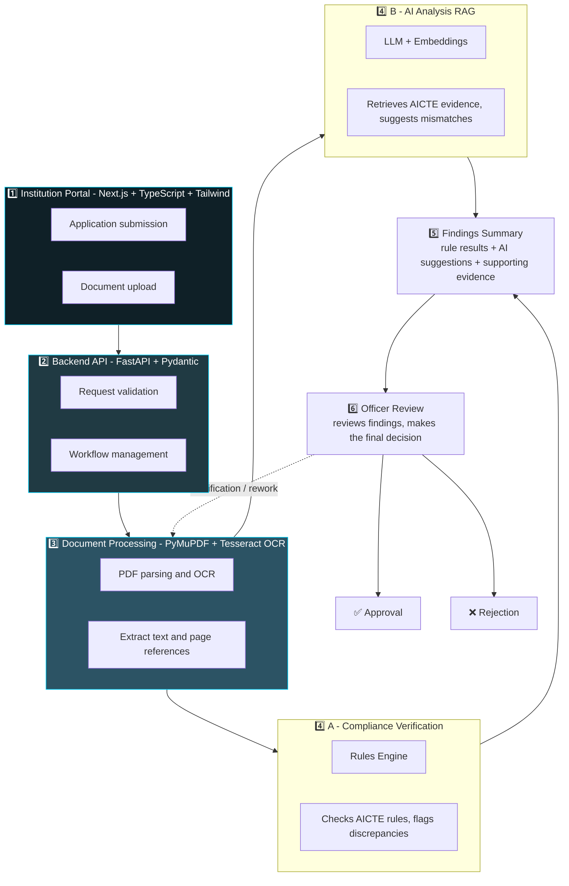
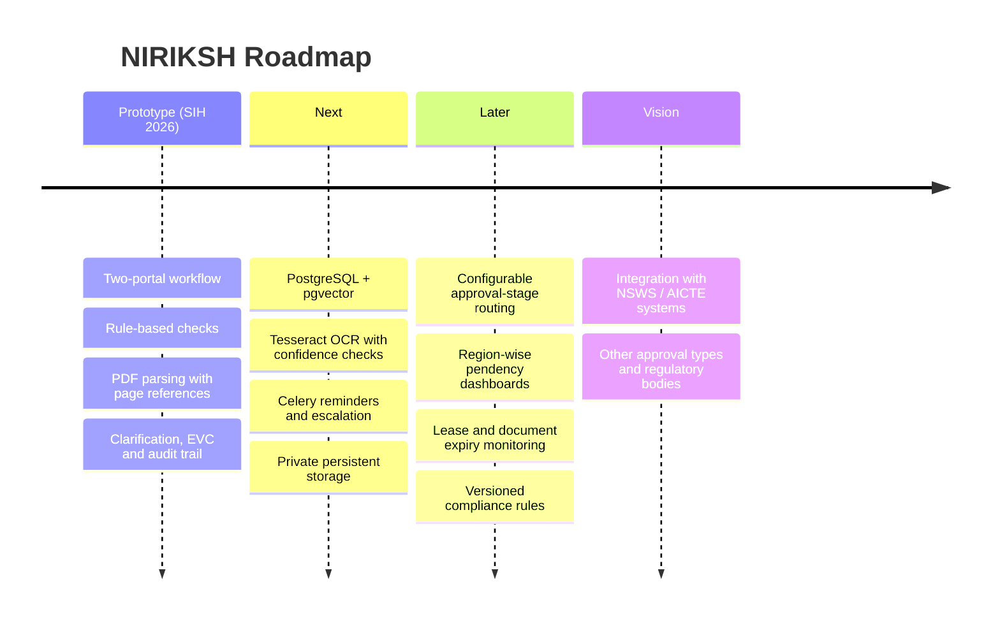

<div align="center">


<a href="https://github.com/AabisTechx/NIRIKSH">
  
</a>

<br/>


<br/>

### 🌐 [**Live Demo**](https://niriksh-frontend.vercel.app) &nbsp;•&nbsp; ⚙️ [**API Docs**](https://niriksh-suta.onrender.com/docs) &nbsp;•&nbsp; 🩺 [**Health Check**](https://niriksh-suta.onrender.com/api/health)

</div>

---

## 📑 Table of Contents

- [✨ What is NIRIKSH?](#-what-is-niriksh)
- [🎯 The Problem](#-the-problem)
- [💡 The Solution](#-the-solution)
- [🌟 Uniqueness & Innovation](#-uniqueness--innovation)
- [🔄 System Workflow](#-system-workflow)
- [🛠️ Technical Approach](#️-technical-approach)
- [🧰 Tech Stack](#-tech-stack)
- [⚙️ Key Features](#️-key-features)
- [📊 Impact & Benefits](#-impact--benefits)
- [🧪 Feasibility & Viability](#-feasibility--viability)
- [📚 Research & References](#-research--references)
- [📸 Screenshots](#-screenshots)
- [🔐 Demo Access](#-demo-access)
- [🖥️ Run Locally](#️-run-locally)
- [🌐 Deployment](#-deployment)
- [📁 Repository Structure](#-repository-structure)
- [🔮 Roadmap](#-roadmap)
- [⚠️ Prototype Limitations](#️-prototype-limitations)
- [👥 Team](#-team)
- [📄 Disclaimer](#-disclaimer)

---

## ✨ What is NIRIKSH?

> **NIRIKSH** is a **centralised web platform** that digitises and streamlines the **AICTE approval workflow**. It combines structured document submission, automated compliance checks against AICTE norms, real-time tracking, alerts and a transparent decision process.

All applications, documents, communications and decisions live in **one unified system**.

<div align="center">

### 🧭 The NIRIKSH Principle

| 🤖 AI only **suggests**, with citations | 📏 Verified, versioned rules **decide** what is non-compliant | 🧑‍⚖️ Officers **own** every decision and deadline action |
|:---:|:---:|:---:|

</div>

<div align="center">

| 📋 Smart India Hackathon 2026 | |
|:---|:---|
| **Problem Statement ID** | `SIH26262` |
| **Problem Statement** | Integrated AICTE Approval Workflow Automation, Compliance Monitoring and Alert Management System |
| **Theme** | Smart Automation |
| **PS Category** | Software |
| **Team Name** | CodeRanger |
| **Team ID** | 198334 |

</div>

---

## 🎯 The Problem

AICTE approval is a multi-stage process: application scrutiny, document verification, compliance monitoring, inspections, and constant communication between institutions and regulatory authorities.

| 😓 Pain Point | 💥 Impact |
|---|---|
| Heavy dependence on emails and physical files | Slow, scattered, hard-to-track scrutiny |
| Manual verification of long, multi-form applications | Inconsistent checks, missed deficiencies |
| Rules buried in long PDFs, not machine-readable | Different interpretations, hard to apply uniformly |
| No real-time visibility of application status | Institutions left guessing, repeated follow-ups |
| Back-and-forth clarification with lost context | Delays and reduced accountability |
| Deadline and pendency management done manually | Missed deadlines, weak oversight |

> 📌 A **unified digital platform** is needed to improve workflow management, application tracking, compliance monitoring, deadline management and **transparency**.

---

## 💡 The Solution

NIRIKSH provides a **role-based, two-portal platform** powered by one backend engine.

<table>
<tr>
<td width="50%" valign="top">

### 🏫 Institution Portal
- 📊 Institution dashboard
- 📝 Structured application submission & tracking
- 📎 Supporting document upload (forms, annexures, certificates)
- 📄 In-app PDF viewing
- 🚦 Real-time application status
- 💬 Clarification requests & resubmission
- 🕒 Communication tracking

</td>
<td width="50%" valign="top">

### 🏛️ AICTE / Officer Portal
- 🔍 Scrutiny dashboard with pre-checked applications
- ✅ Document review & verification
- 📌 Compliance findings with supporting evidence
- 📏 Rule-based compliance checks
- 🤖 AI-assisted document analysis
- ❓ Clarification requests to institutions
- ⚖️ Decision management
- 🔎 EVC & inspection workflow
- 👁️ Supervisor overview & 🧾 audit trail

</td>
</tr>
</table>

### 🎯 How it addresses the problem

| Problem | NIRIKSH's answer |
|---|---|
| Manual verification, emails & physical files | Digital, structured submission with automated checks |
| Inconsistent scrutiny | Checks every application against the latest AICTE rules and checklists |
| Delays and missed deadlines | Real-time status tracking and proactive alerts |
| Lack of transparency | An audit trail for every action |

---

## 🌟 Uniqueness & Innovation

<div align="center">

| 🔗 End-to-end traceability | 🗂️ Unified multi-document view |
|:---|:---|
| Every finding is linked to the **exact document page** and the **applicable AICTE rule clause** | Correlates information across **multiple forms, annexures** and supporting documents |

| 📏 Rule-based compliance engine | 👥 User-friendly, role-based workflow |
|:---|:---|
| Checks against the **latest AICTE norms** and highlights exceptions | Dashboards for **institutions, officers and supervisors** with real-time alerts and audit trail |

</div>

---

## 🔄 System Workflow



| # | Stage | What happens |
|:-:|---|---|
| 1️⃣ | **Application Submission** | Institution submits the application with required documents |
| 2️⃣ | **Document Processing** | Documents are read, structured, and key fields extracted via OCR and parsing |
| 3️⃣ | **AI-Assisted Analysis (RAG)** | Passages are retrieved from official AICTE documents; an LLM analyses the retrieved evidence |
| 4️⃣ | **Compliance Verification** | Application is checked against AICTE norms, rules and checklists; mismatches are flagged |
| 5️⃣ | **Officer Review** | The assigned officer reviews AI findings and documents |
| 6️⃣ | **Clarification / Rework** | If non-compliant, the institute receives remarks and resubmits, and the cycle repeats |
| 7️⃣ | **EVC (if required)** | Visit scheduling → visit report → authorised officer's final decision |
| 8️⃣ | **Decision** | Approval letter is generated, or rejection reason is shared with the rule clause |
| 9️⃣ | **Monitoring & Alerts** | Tracks pending actions, sends deadline reminders, keeps the audit trail |

---

## 🛠️ Technical Approach



### 🧱 Supporting Components

| Component | Role |
|---|---|
| 🐘 **PostgreSQL (+ pgvector)** | Database, audit logs and vector storage for embeddings |
| 🔗 **SQLAlchemy + Alembic** | Database access and migrations |
| 🥬 **Celery** | Background tasks and deadline reminders |
| ☁️ **Private Cloud Storage** | Private, access-controlled document files |
| 🔑 **RBAC** | Role-based access for institutions, officers and supervisors |
| 🔎 **EVC** | Visit scheduling, if required |

---

## 🧰 Tech Stack

<div align="center">

| Layer | Technology |
|:---:|---|
| 🎨 **Frontend** |    |
| ⚙️ **Backend** |    |
| 📄 **Document Parsing** | PyMuPDF • Tesseract OCR |
| 🤖 **AI / RAG** | LLM API • Embeddings |
| 🗄️ **Database** |  pgvector •  Alembic |
| ⏱️ **Task Scheduler** |  |
| 🛡️ **Security & DevOps** | RBAC • Private Cloud/Storage • Pytest •  |

</div>

### 🧭 Target Architecture vs. Live Prototype

The stack above is NIRIKSH's **proposed architecture**. The hosted prototype implements a focused subset of it:

| Capability | Prototype (live) | Target architecture |
|---|:---:|:---:|
| Two-portal UI (Institution / Officer) | ✅ | ✅ |
| FastAPI backend with Pydantic schemas | ✅ | ✅ |
| PDF parsing with page-level references (PyMuPDF) | ✅ | ✅ |
| Rule-based compliance checks | ✅ | ✅ |
| AI-assisted, RAG-oriented analysis | ✅ | ✅ (LLM API + embeddings + pgvector) |
| Clarification and resubmission workflow | ✅ | ✅ |
| EVC workflow support | ✅ | ✅ |
| Audit trail | ✅ | ✅ |
| Database | SQLite + SQLAlchemy | PostgreSQL + pgvector, Alembic migrations |
| OCR for scanned documents | 🔜 | Tesseract OCR with confidence checks |
| Background reminders & escalation | 🔜 | Celery |
| Private, persistent document storage | 🔜 | Private cloud storage |
| Advanced RBAC & versioned rules | 🔜 | ✅ |

---

## ⚙️ Key Features

| | Feature | Description |
|:-:|---|---|
| 📄 | **Document Parsing** | PDF/OCR parsing with page tracking |
| 🔗 | **End-to-End Traceability** | Every finding linked to the exact document page and AICTE rule clause |
| 🗂️ | **Unified Multi-Document View** | Correlates data across forms, annexures and supporting documents |
| 📏 | **Rule-Based Verification** | Flags missing or inconsistent information against the latest AICTE norms |
| 🤖 | **RAG-Based Evidence Retrieval** | Retrieves supporting evidence from official AICTE documents |
| ⏰ | **Deadline-Aware Workflow** | Real-time reminders and escalation for delayed actions |
| 🔑 | **Role-Based Access Control** | Separate access for institutions, officers and supervisors |
| 🧬 | **Versioned Rules & Audit Logs** | Every action logged with timestamp, user and rule reference |
| 🧑‍⚖️ | **Human-Driven Final Decision** | AI and automation only assist; officers decide |
| 🧩 | **Modular, Scalable Architecture** | Extensible to other approval types and regulatory bodies |

---

## 📊 Impact & Benefits

### 👥 Impact on Target Audience

<table>
<tr>
<td width="50%" valign="top">

**🏫 Institutions (AICTE, HEIs)**
- Faster, more transparent approval process
- Reduced manual workload and better compliance
- Real-time visibility of status and deficiencies

**🔍 Scrutiny & Regional Officers**
- Pre-checked applications with highlighted mismatches
- Evidence-linked references to rules and source documents
- Simplified workload via a structured dashboard

</td>
<td width="50%" valign="top">

**⚖️ Authorised Decision-Makers**
- Consolidated case summary with compliance status
- Consistent, informed decision-making
- Less back-and-forth communication

**📋 Supervisors & Auditors**
- Complete audit trail for every action
- Easy monitoring of pending cases and escalations
- Tracks EVC visit schedules, pending reports and delays
- Improved accountability and traceability

</td>
</tr>
</table>

### 🌍 Benefits of the Solution

| Type | Benefit | Supporting Example |
|---|---|---|
| 🤝 **Social** | More transparent and consistent scrutiny, building trust among institutions | Clear status and reason for every decision visible to stakeholders |
| 💼 **Economic / Operational** | Less manual follow-up and document searching, leading to significant time savings | Faster case processing and reduced office effort *(to be quantified in pilot)* |
| 🌱 **Environmental** | Reduced paper usage through a complete digital workflow and records | All applications, documents and communications in digital form |
| 🏛️ **Governance** | Accountable decisions with versioned rules and a complete audit trail | Every action logged with timestamp, user and rule reference |

---

## 🧪 Feasibility & Viability

<table>
<tr>
<td width="33%" valign="top">

### ⚙️ Feasibility
- **Technical:** Proven technologies (Next.js, Python, FastAPI, PostgreSQL, OCR, Celery) form a scalable foundation
- **Operational:** Structured submission, officer workflow, real-time tracking and alerts
- **Data:** Can be built and tested using publicly available AICTE handbook formats and synthetic cases
- **Integration:** Starts standalone; can later integrate with NSWS/AICTE systems with proper authorisation

</td>
<td width="33%" valign="top">

### 🚧 Challenges & Mitigation
- **Document quality** → OCR with confidence checks and manual review
- **Rule accuracy** → Versioned rules and source citations from official documents
- **Data privacy & security** → Role-based access, encryption and audit logging
- **Adoption & change** → Simple UI, training and phased rollout
- **EVC scheduling** → Visit-status tracking, reminders and authorised rescheduling

</td>
<td width="33%" valign="top">

### 📈 Viability
- **Economic:** Open-source stack; hosting and support costs can be estimated during a pilot
- **Scalability:** Modular architecture supports more approval workflows and regulatory bodies
- **Sustainability:** Maintainable by institutions/AICTE at minimal recurring cost on standard cloud infrastructure
- **Social impact:** Transparency, accountability and quicker processing for institutes, officers and students

</td>
</tr>
</table>

---

## 📚 Research & References

NIRIKSH's design is grounded in published research and official AICTE sources.

| Reference | What it covers | Research gap | How NIRIKSH responds |
|---|---|---|---|
| **AICTE Approval Process Handbook 2024-25 to 2026-27** | Official rules, application types and annexure formats | Rules sit in long PDFs, not machine-readable | Verified rules as versioned data; RAG over official text only |
| **OmniDocBench** (Ouyang et al., CVPR 2025) | Benchmarks PDF parsing across layouts | General benchmarks don't prove accuracy on AICTE forms | Evaluate extraction on labelled synthetic cases; record page and confidence |
| **MMLongBench-Doc** (Ma et al., NeurIPS 2024) | Long, multi-page document understanding | Cross-page evidence and long-context reasoning remain difficult | Link every finding to its source document and page; flag uncertainty |
| **Fact, Fetch, and Reason** (Krishna et al., NAACL 2025) | Evaluates retrieval, factuality and reasoning in RAG | Good retrieval alone can't guarantee a correct answer | Use verified AICTE sources and citation-backed, rule-based checks |
| **Tesseract OCR Engine** (Smith, ICDAR 2007) | Open-source OCR pipeline for scans | Poor scans can cause silent extraction errors | OCR fallback, confidence thresholds and manual review |
| **FUNSD** (Jaume et al., ICDARW 2019) | Labelled forms for document understanding | A public dataset can't represent every AICTE annexure | Supplementary benchmark; validate on synthetic AICTE-style cases |
| **RAC** (Li & Flanigan, EMNLP Findings 2025) | Retrieval-assisted factuality correction | Correction methods don't replace authoritative decisions | Require citations; officers retain final approval or rejection |

**Official sources used:** [AICTE Approval Process Handbook](https://www.aicte.gov.in/sites/default/files/APH%20Final.pdf) • [AICTE approval process page](https://www.aicte.gov.in/node/2869) • [National Single Window System (NSWS)](https://www.nsws.gov.in)

> 🏆 **Proposed contribution:** an **evidence-first approval workflow** where AI only suggests with citations, verified versioned rules decide what is non-compliant, and officers own every decision and deadline action.

---

## 📸 Screenshots

> 💡 Add your screenshots to a `docs/screenshots/` folder and the images below will render automatically.

<div align="center">

| 🏫 Institution Dashboard | 🏛️ Officer Dashboard |
|:---:|:---:|
|  |  |

| 📌 Compliance Findings | ❓ Clarification Workflow |
|:---:|:---:|
|  |  |

</div>

---

## 🔐 Demo Access

Try both portals live at **[niriksh-frontend.vercel.app](https://niriksh-frontend.vercel.app)**.

| Portal | Username | Password |
|:---:|:---:|:---:|
| 🏫 Institution | `INST-DTI-2026` | `Niriksh@2026` |
| 🏛️ Officer | `AICTE-OFF-8841` | `Aicte#Scrutiny26` |

> ⚠️ These are **demonstration credentials** for **synthetic sample data only**. They are not real institutional or government accounts.
>
> ⏳ The backend runs on a hosted free-tier service, so the **first request may take a little while** to wake up.

---

## 🖥️ Run Locally

**Prerequisites:** Python 3.9+ • Node.js 18+ • Git • a modern web browser

### 1️⃣ Clone the repository

```bash
git clone https://github.com/AabisTechx/NIRIKSH.git
cd NIRIKSH
```

### 2️⃣ Start the backend (FastAPI)

```bash
cd backend
pip install -r requirements.txt
uvicorn main:app --reload --host 127.0.0.1 --port 8000
```

### 3️⃣ Start the frontend (Next.js)

Open a new terminal:

```bash
cd frontend
npm install
npm run dev
```

| 🔗 | URL |
|---|---|
| 🌐 Frontend | http://localhost:3000 |
| ⚙️ Backend API | http://127.0.0.1:8000 |
| 📘 API Docs | http://127.0.0.1:8000/docs |

> 🔌 Make sure the frontend points at your backend URL (`http://127.0.0.1:8000` locally).
>
> 🌱 Sample data is seeded automatically when the database is empty.

🪟 **On Windows?** You can also use the included launcher: `START_NIRIKSH_WINDOWS.bat`.

---

## 🌐 Deployment

NIRIKSH deploys as **two services**: a Next.js frontend and a FastAPI backend.

| Component | Platform | Status |
|---|:---:|:---:|
| 🎨 Frontend (Next.js) | Vercel | 🟢 Live |
| ⚙️ Backend API | Render | 🟢 Live |
| 📘 API Docs | Render | 🟢 Live |
| 💻 Source Code | GitHub | 🟢 Public |

<details>
<summary><b>🔧 Backend on Render</b></summary>

- Create a **Web Service** from this repository
- **Root Directory:** `backend`
- **Runtime:** Python 3
- **Build Command:** `pip install -r requirements.txt`
- **Start Command:** `uvicorn main:app --host 0.0.0.0 --port $PORT`
- Set `NIRIKSH_CORS_ORIGINS` to your exact Vercel origin (no trailing slash)
- Test at `/api/health`

**Optional persistence** (attach a Render persistent disk mounted at `/var/data`):

```bash
NIRIKSH_DB_PATH=/var/data/niriksh_demo.db
NIRIKSH_UPLOAD_DIR=/var/data/uploads
```

</details>

<details>
<summary><b>🎨 Frontend on Vercel (Next.js)</b></summary>

- Import the repository as a new Vercel project
- **Root Directory:** `frontend`
- **Framework Preset:** Next.js
- **Install Command:** `npm install`
- **Build Command:** `npm run build`
- Point the frontend at your deployed Render backend URL (no trailing slash)
- Make sure the Vercel origin matches `NIRIKSH_CORS_ORIGINS` on Render

</details>

<details>
<summary><b>🧪 Smoke test checklist</b></summary>

Login • dashboard loading • case details • compliance checks • PDF display/upload • clarification & resubmission • EVC • audit logs

</details>

See [`DEPLOYMENT_GUIDE.md`](DEPLOYMENT_GUIDE.md) for the full walkthrough.

---

## 📁 Repository Structure

```
NIRIKSH/
│
├── 📂 backend/
│   ├── main.py              # FastAPI app entry point
│   ├── database.py          # Database setup
│   ├── models.py            # SQLAlchemy models
│   ├── schemas.py           # Pydantic schemas
│   ├── requirements.txt
│   ├── services/            # Business logic
│   ├── sample_data/         # Synthetic demo data
│   ├── scripts/
│   └── test_niriksh.py      # Tests
│
├── 📂 frontend/             # Next.js application
│   └── package.json
│
├── 📄 generate_sample_pdf.py
├── 🪟 START_NIRIKSH_WINDOWS.bat
├── 📘 DEPLOYMENT_GUIDE.md
├── 🔑 .env.example
└── 📖 README.md
```

---

## 🔮 Roadmap



- [ ] 🛣️ Configurable approval-stage routing
- [ ] 🗺️ Region-wise pendency and workload dashboards
- [ ] ⏱️ Time-bound undertaking tracking
- [ ] 📅 Lease and document expiry monitoring
- [ ] 🔔 Automated reminders and escalation mechanisms
- [ ] 🔒 Secure persistent document storage
- [ ] 🔗 Integration with NSWS / AICTE systems, with proper authorisation
- [ ] 🛡️ Enhanced role-based access control
- [ ] 🧬 Compliance rule versioning and validation

> These are proposed enhancements, not claims of completed implementation.

---

## ⚠️ Prototype Limitations

NIRIKSH is a **Smart India Hackathon 2026 prototype**.

- Uses **synthetic demonstration data** only
- AI-assisted analysis **supports, but never replaces,** authorised officer scrutiny
- The demo uses **SQLite**; persistent database and document storage are not guaranteed
- Integration with official AICTE and government systems is **not claimed**
- Production use would need security audits, persistent storage, monitoring and regulatory validation

---

## 👥 Team

<div align="center">

| 🏆 Team | 🎪 Competition | 🆔 Problem Statement | 🚀 Project |
|:---:|:---:|:---:|:---:|
| **CodeRanger** | Smart India Hackathon 2026 | SIH26262 | **NIRIKSH** |

</div>

---

## 📄 Disclaimer

NIRIKSH is an independent prototype developed for Smart India Hackathon 2026. It is **not** an official AICTE application or government service, and is not affiliated with or endorsed by AICTE or the Ministry of Education. All demonstration records are synthetic. Final regulatory decisions must remain with the competent authorities.

---

<div align="center">

### ⭐ If you find this project interesting, consider giving it a star!

**NIRIKSH — Making Institutional Approval Workflows More Transparent, Traceable and Accountable.**


</div>
